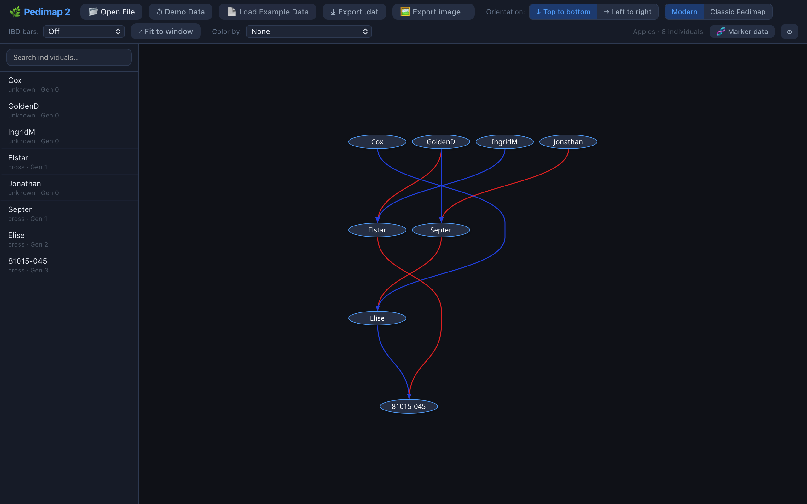

# Chapter 1 — Introduction

## What Pedimap 2 does

Pedimap 2 draws the pedigree of a plant breeding population as a chart:
every individual is a box (or a symbol), and lines join each individual to
its parents, generation by generation. On that chart you can show what you
know about each plant:

- **trait values**, as the color of each box;
- **marker genotypes**, as colors by genotype code or by the number of
  copies of an allele;
- **IBD probabilities** (identity by descent), as bars inside each box that
  show which founder each of the plant's two chromosome copies descends
  from, along a linkage group.

Click a plant to see all of its data in a details panel, build a
subpopulation around it, and export the chart as a figure for a report or a
paper.

Pedimap 2 runs on your own computer, on macOS, Windows and Linux. Your data
never leaves it: there is no account and no upload.

## Who it is for

Pedimap 2 is for plant breeders and geneticists who work with
multi-generation crossing programs: following where a trait or an allele
came from, checking parentage, or showing the results of a pedigree-based
QTL analysis. It reads the files that Pedimap 1.x reads, and the pedigree
files that FlexQTL and Binko.jl write for Pedimap.

You do not need to program to use it.

## What you can do with it

| To… | See |
|------------------------------|----------------|
| install Pedimap 2 or update it | [Chapter 2](02_installation.md) |
| try it out on the example pedigree in a few minutes | [Chapter 3](03_quickstart.md) |
| prepare a data file, or understand an error message about one | [Chapter 4](04_file_formats.md) |
| find your way around the window | [Chapter 5](05_interface.md) |
| color the chart by a trait or a marker, or read the IBD bars | [Chapter 6](06_visualization.md) |
| save a figure, or save the pedigree as a data file | [Chapter 7](07_data_export.md) |
| work with large pedigrees and subpopulations | [Chapter 8](08_advanced.md) |
| find an answer to a common question, or a term | [Chapter 9](09_faq.md) |

## Pedimap 1.x and Pedimap 2

Pedimap 2 is the successor of Pedimap (Voorrips et al. 2012), which many
breeding programs have used since 2012. Pedimap 1.x runs only on Windows,
and its source can no longer be built, so Pedimap 2 was written anew for
current computers.

Pedimap 2 opens Pedimap 1.x data files (`.dat`) as they are. It does not yet
have every feature of Pedimap 1.x: view tabs, the population panel and some
of the ways to select relatives, for example, are still to come.
[Appendix A](09_faq.md#appendix-a-pedimap-2-and-the-original-pedimap) lists what is
available and what is not.

## Citing Pedimap

If you use Pedimap 2 in published research, please cite both the original
paper and Pedimap 2:

> Voorrips RE, Bink MCAM, Van de Weg WE (2012) Pedimap: software for the
> visualization of genetic and phenotypic data in pedigrees. *J. Hered.*
> 103:903–907. doi:10.1093/jhered/ess060

> Fresnedo-Lab (2026) Pedimap 2: modern multiplatform pedigree visualization
> for plant breeding. https://github.com/Fresnedo-Lab/pedimap2

## License

Pedimap 2 is free software under the MIT license.
