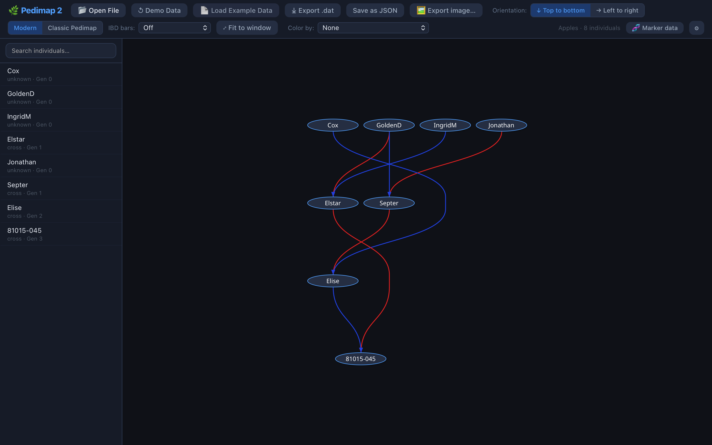
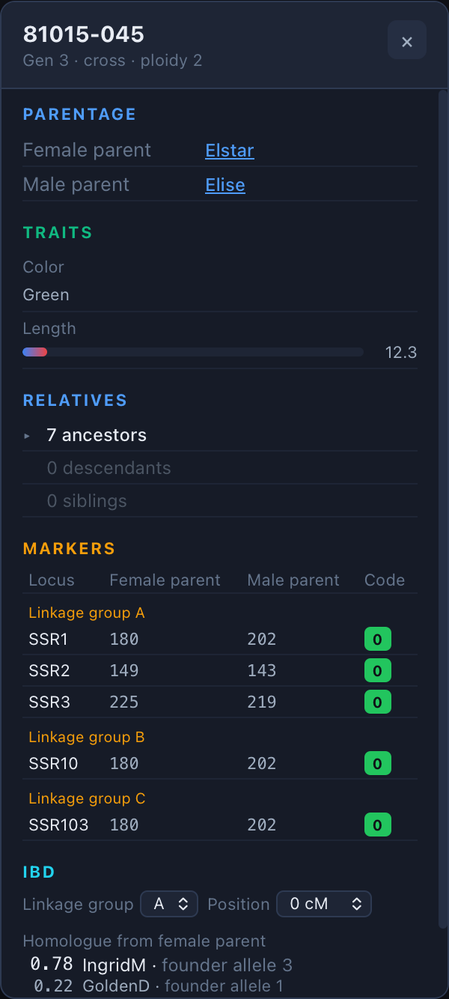
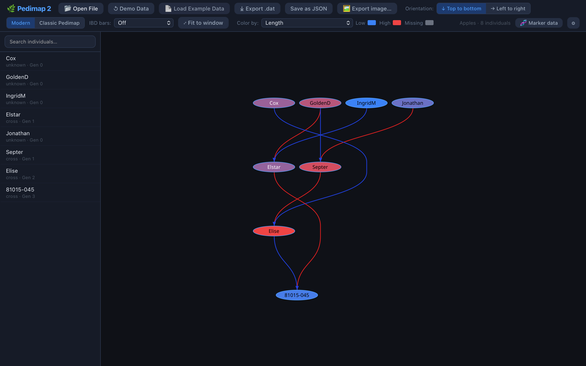
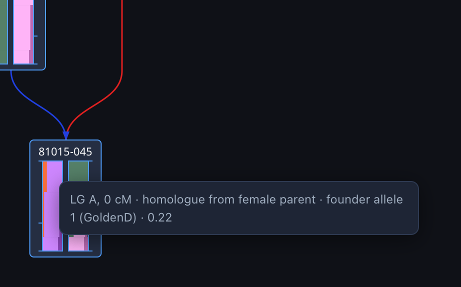
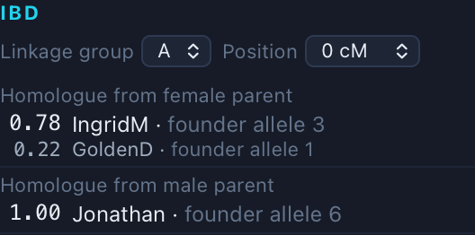
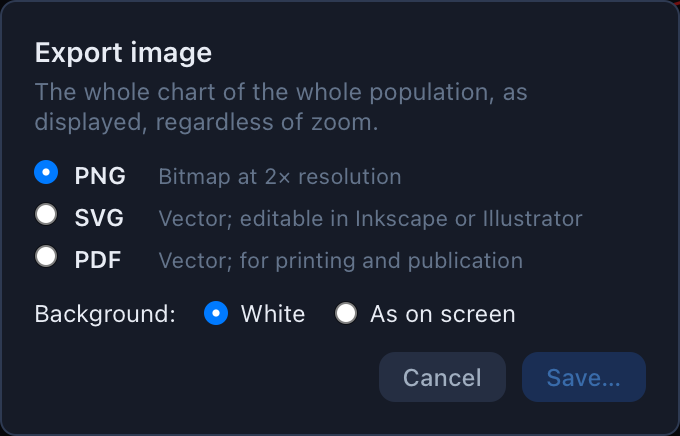

# Chapter 3 — Quick start

This tutorial takes about ten minutes. It uses the example pedigree that
comes with Pedimap 2, so you need no data of your own. You will open the
example, read the chart, look at one plant in detail, color the chart by a
trait, show the IBD bars, and save a figure.

## Step 1: Open the example

Click **Load Example Data** in the toolbar.

This is the apple pedigree that came with the original Pedimap: 8 plants in
4 generations, two traits (`Color`, with values such as Red and Green, and
`Length`, a number), 5 markers on 3 linkage groups, and IBD probabilities.
The cultivar names are real, but the relationships, trait values and
genotypes in this example are fictitious.

The window now shows:

- the **toolbar** at the top;
- the **list of individuals** on the left, with each plant's cross type and
  generation, and a search box above it;
- the **chart** in the middle.

## Step 2: Read the chart

- **Generations run from top to bottom.** The four founders (Cox, GoldenD,
  IngridM and Jonathan, generation 0) are in the top row; their offspring are
  in the rows below; 81015-045, in generation 3, is at the bottom.
- **Each line joins a plant to one of its parents**, with the arrow pointing
  to the offspring. The line from the **first parent** is red, the line from
  the **second parent** is blue. In this file the parent columns are named
  FEMALE and MALE, so the first parent is the female (the seed parent) and
  the second the male. Files from FlexQTL and Binko.jl name their columns
  PARENT1 and PARENT2 and do not state which parent is which sex
  ([Chapter 6](06_visualization.md) gives the rule for every file). A plant
  with a single parent (from selfing, for example) has one purple line.
- **Lines never pass through a plant they do not connect.** A line that
  spans more than one generation runs in a lane of its own.

To move around:

- drag the background to move the chart, and scroll (or pinch) to zoom;
- press **F**, or click **Fit to window**, to see the whole chart again;
- drag a plant sideways to move it within its row.

Hold the mouse over a plant to see its parents, generation and trait
values.

## Step 3: Look at one plant

Click **81015-045**, at the bottom of the chart (or click its name in the
list on the left). The **details panel** opens on the right.

From top to bottom it shows:

- **Parentage:** its parents, Elstar and Elise, labeled as the file names
  them ("Female parent" and "Male parent" here). Click a parent's name to
  move to that plant.
- **Traits:** Color is Green; Length is 12.3, with a bar showing where 12.3
  lies in the range of Length.
- **Relatives:** 7 ancestors, no descendants, no siblings. Click a line to
  list them.
- **Markers:** the plant's two alleles at each marker, by linkage group,
  with the genotype code of each as a small colored badge.
- **IBD:** which founder each of its two chromosome copies comes from (see
  Step 5).

Click **×** at the top right of the panel to close it.

## Step 4: Color the chart by a trait

In the toolbar, choose **Color by: Length**.

Each plant now takes a color between blue (the lowest Length) and red (the
highest). Next to the menu, the toolbar shows the colors for **Low**,
**High** and **Missing**; click one to choose another color.

Choose **Color by: Color** to see the other trait: each value gets its own
color, and values that are color names (Red, Green) are drawn in that color.

Choose **Color by: None** to go back.

## Step 5: Show the IBD bars

The example file includes IBD probabilities: for each plant, the
probability that each of its two chromosome copies descends from each of
the founders' alleles, at a few positions along each linkage group.

In the toolbar, choose **IBD bars: Linkage group A**.

Every plant's box now holds two bars. Each bar is one chromosome copy
(homologue), along linkage group A from 0 cM at the top to 29 cM at the
bottom:

- the **left bar** is the copy from the first parent, the **right bar** the
  copy from the second parent;
- each founder has its own color, in a light and a dark shade for its two
  alleles: GoldenD orange, IngridM purple, Jonathan green, Cox pink. A legend
  at the lower left of the chart lists them; click its title to collapse it;
- where the data cannot tell which founder allele a segment comes from, the
  bar is split across its width in proportion to the probabilities. A split
  shows **uncertainty, not a mixture**: each segment of a homologue descends
  from exactly one founder allele, and the split shows how likely each one
  is.

The founders' own bars are a single color each: a founder carries its own
two alleles.

Now hold the mouse over the top of 81015-045's **left** bar, on its thin
orange stripe:

The tooltip reads "LG A, 0 cM · homologue from female parent · founder
allele 1 (GoldenD) · 0.22". Move the mouse right, onto the purple part, and
it reads founder allele 3 (IngridM), 0.78. So at 0 cM, the chromosome copy
that 81015-045 received from Elstar descends either from IngridM's allele 3
or from GoldenD's allele 1: probably IngridM's (0.78), possibly GoldenD's
(0.22). It is one or the other, not a blend of both.

Why can the data not tell? Elstar is a cross of GoldenD and IngridM, so this
segment came from one of them. The marker at 0 cM is SSR1, and on this
homologue 81015-045 carries SSR1 allele 180. Both GoldenD's founder allele 1
and IngridM's founder allele 3 are allele 180 (the file's `FOUNDERALLELES`
line for SSR1 says so): they are **identical by state**, so SSR1 cannot tell
them apart. The probabilities themselves come from the analysis that
produced the file.

The same numbers are in the details panel. Click 81015-045, scroll to
**IBD**, and choose linkage group **A** and position **0 cM**:

The copy from the second parent, Elise, is Jonathan's allele 6 with
probability 1.00 at this position. This homologue carries SSR1 allele 202,
and among the eight founder alleles only Jonathan's allele 6 is 202.

To make the bars wider or to change the colors, click the **Settings**
button (the gear at the top right) and use its **IBD bars** section
([Chapter 6](06_visualization.md) explains how to read the bars in
detail). Choose **IBD bars: Off** to go back to the plain chart.

## Step 6: Save a figure

Click **Export image…** in the toolbar.

1. Choose a format: **PNG** (a picture, at twice the screen resolution),
   **SVG** (a drawing you can edit in Inkscape or Illustrator) or **PDF**
   (for printing and publication; you can also choose the page size).
2. Choose the background: **White**, for print, or **As on screen**.
3. Click **Save…** and choose where to save the file.

The image always shows the whole chart as displayed (all plants, colors and
IBD bars), however far you have zoomed in, with a legend for the coloring
and for the IBD bars.

## Where next

- To open your own data, click **Open File** and choose a `.dat`, `.ped`,
  `.pmp` or `.json` file. [Chapter 4](04_file_formats.md) describes the
  files Pedimap reads.
- To learn every part of the window, see [Chapter 5](05_interface.md).
- To read the colors and the IBD bars in depth, see
  [Chapter 6](06_visualization.md).
