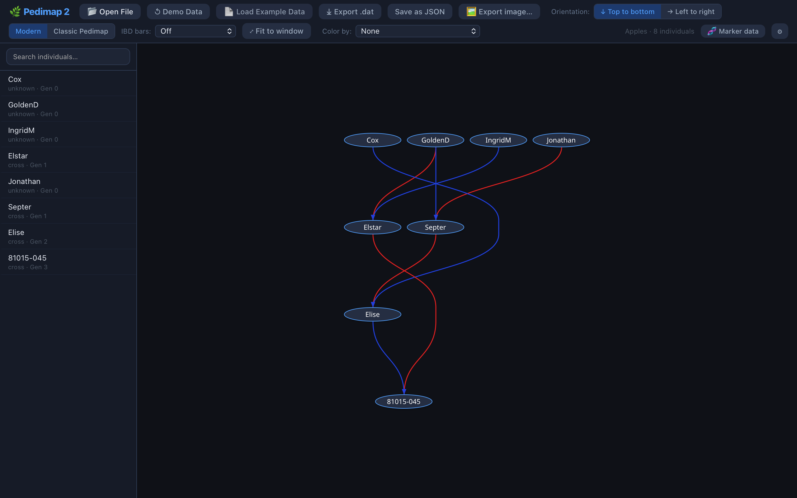
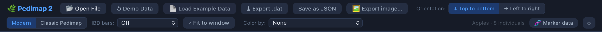
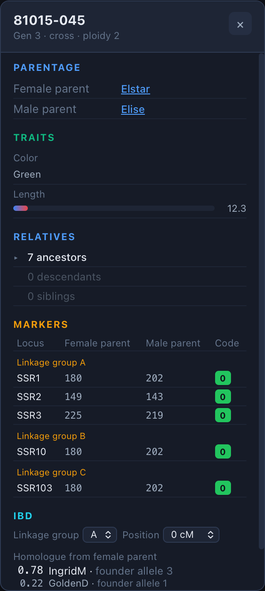
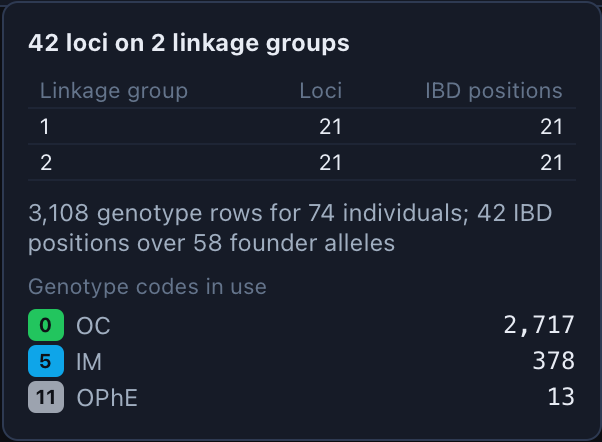
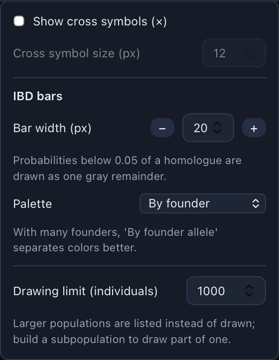

# Chapter 5 — The Pedimap window

The window has three parts: the **toolbar** at the top, the **list of
individuals** on the left, and the **chart**. Clicking an individual opens
the **details panel** on the right.

## The toolbar

**First row**

| Control | What it does |
|----------------|------------------------------------------------------------|
| **Open File** | Opens a `.dat`, `.ped`, `.pmp` (with its `.dat`) or `.json` file ([Chapter 4](04_file_formats.md)) |
| **Demo Data** | Shows the small made-up demo pedigree that Pedimap starts with |
| **Load Example Data** | Opens the example apple pedigree of [Chapter 3](03_quickstart.md) |
| **Export .dat** | Saves the pedigree as a `.dat` file. While a subpopulation is shown, it reads **Export subpopulation (.dat)** ([Chapter 7](07_data_export.md)) |
| **Save as JSON** | Saves the whole population, with all of its data, as a Pedimap 2 JSON file ([Chapter 7](07_data_export.md)) |
| **Export image…** | Saves the chart as a PNG, SVG or PDF image ([Chapter 7](07_data_export.md)) |
| **Orientation** | **Top to bottom** (generations as rows) or **Left to right** (generations as columns) |
| **Modern** / **Classic Pedimap** | The display style ([Chapter 6](06_visualization.md)) |

**Second row**

| Control | What it does |
|---------|------------------------------------------------------------|
| **IBD bars** | Off, or the linkage group whose IBD bars every box shows. Only for files with IBD probabilities, and only the linkage groups that have them |
| **Fit to window** | Shows the whole chart again (or press **F**) |
| **Color by** | None, a trait, **Genotype code at marker…** or **Allele at marker…** (the last two for files with marker data). For a marker, a **Marker** menu appears next to it, and for an allele, an **Allele** menu. For a continuous trait, the **Low**, **High** and **Missing** colors appear; click one to change it, and **Reset** to go back to the trait's own colors |
| **Subpop:** *name* | Appears when an individual is selected: shows its ancestors and descendants only ([Chapter 8](08_advanced.md)) |
| **Show All** | Appears while part of the pedigree is shown: shows the whole pedigree again |
| Population name | The pedigree's name and the number of individuals |
| **Marker data** | A summary of the file's markers (see below). Only for files with marker data |
| Gear button | **Settings** (see below) |
| **About** | The version, and updates ([Chapter 2](02_installation.md)) |

## The chart

**Moving around**

- Drag the background to move the chart; scroll, or pinch on a trackpad, to
  zoom.
- Press **F**, or click **Fit to window**, to see the whole chart.
- Click the chart, and then the arrow keys move it and **+** and **–** zoom.
  The keys act only on the chart: while you type in the search box, they
  type.

**Individuals**

- Hold the mouse over an individual to see its parents, generation and trait
  values. With IBD bars shown, holding it over a bar shows the founder
  allele at that spot instead ([Chapter 6](06_visualization.md)).
- Click an individual to select it and open its details panel.
- Drag an individual sideways to move it within its row. It cannot pass its
  neighbors in the row, so lines keep clear of every box.

**Legends** sit at the lower left of the chart: the legend of a discrete
coloring, and above it, while IBD bars are shown, the legend of the founder
alleles. Click the founder-allele legend's title to collapse it to that
title; Pedimap remembers your choice.

A large pedigree takes a moment to arrange; Pedimap then shows "Laying
out…" first. Above the drawing limit, the individuals are listed instead of
drawn ([Chapter 8](08_advanced.md)).

## The list of individuals and the search box

The list on the left shows every individual of the pedigree, with its cross
type and generation. Type in the search box above it to keep only the names
that contain what you type (upper or lower case does not matter). Click a
name to select that individual.

## The details panel

The panel shows everything known about the selected individual. Under its
name: its generation, its cross type and its ploidy.

- **Parentage:** its two parents, labeled as the file names them ("Female
  parent" and "Male parent", or "Parent 1" and "Parent 2"). Data that does not
  name its parent columns, such as the demo data, has "Parent 1" and "Parent
  2". Click a parent to select it.
- **Traits:** each trait value; a continuous value with a bar showing where it
  lies in the trait's range.
- **Relatives:** the numbers of ancestors, descendants and siblings. Click a
  line to list them, and click a name in the list to select that individual.
- **Markers:** for each linkage group, each locus with the individual's two
  alleles, in the order of the file's parent columns, and the genotype code as
  a colored badge. Hold the mouse over a badge to see what the code means:
  FlexQTL's meaning in FlexQTL and Binko files
  ([Appendix B](09_faq.md#appendix-b-flexqtl-genotype-codes)), otherwise just
  that it is a color code. Individuals without marker data say so.
- **IBD:** choose a **Linkage group** and a **Position**. For each of the two
  chromosome copies, the panel lists the most probable founder allele with
  its founder and probability, and the next most probable when its
  probability is above 0.10.

Click **×** at the top of the panel to close it.

## Marker data

**Marker data**, next to the population name, opens a summary of the file's
marker data: the loci and IBD positions on each linkage group, the number of
genotype rows and of individuals they cover, the number of founder alleles,
and the genotype codes in use with how often each occurs.

## Settings

The gear button at the top right opens the settings.

| Setting | What it does |
|----------------|------------------------------------------------------------|
| **Show cross symbols (×)** | Draws a × where the lines from two parents meet, one per parent pair, shared by full sibs. On by default in Classic Pedimap, off in Modern; each style keeps its own choice |
| **Cross symbol size (px)** | The size of the ×, from 4 to 40 |
| **IBD bars: Bar width (px)** | The width of each IBD bar, from 6 to 40 (20 by default). The line below says which probabilities this merges into a gray remainder ([Chapter 6](06_visualization.md)). Shown for files with IBD probabilities |
| **IBD bars: Palette** | **By founder** or **By founder allele** ([Chapter 6](06_visualization.md)) |
| **Drawing limit (individuals)** | Above this many individuals, the pedigree is listed instead of drawn (1,000 by default; [Chapter 8](08_advanced.md)) |

Pedimap remembers your settings, and the display style, orientation and
colors you choose, the next time you open it.

## Messages above the chart

- An **amber bar** lists warnings about the file just opened (for example a
  parent name that may be misspelled). Click **Dismiss** to close it.
  [Chapter 4](04_file_formats.md) explains the common ones.
- A **note about the text encoding** appears when a file was saved in an
  older encoding; its accented names were still read correctly.
- An **error** says why a file could not be opened, or what went wrong.
- A **blue bar** offers a new version of Pedimap
  ([Chapter 2](02_installation.md)).
