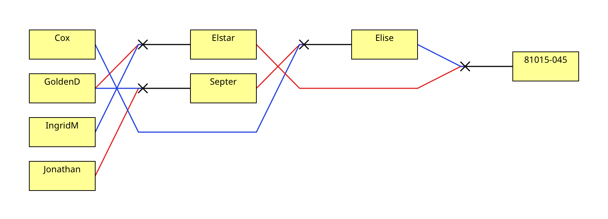
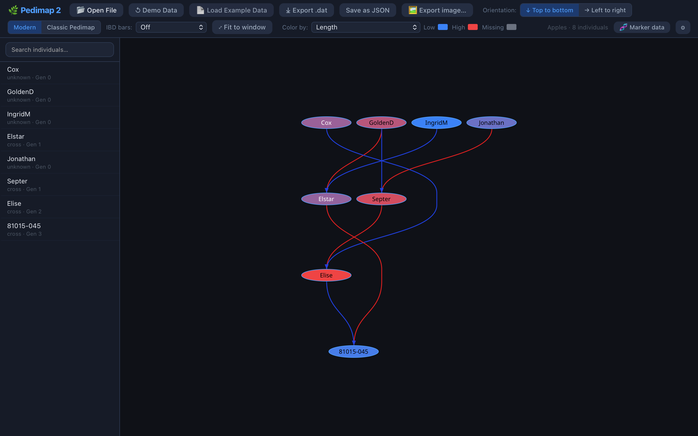
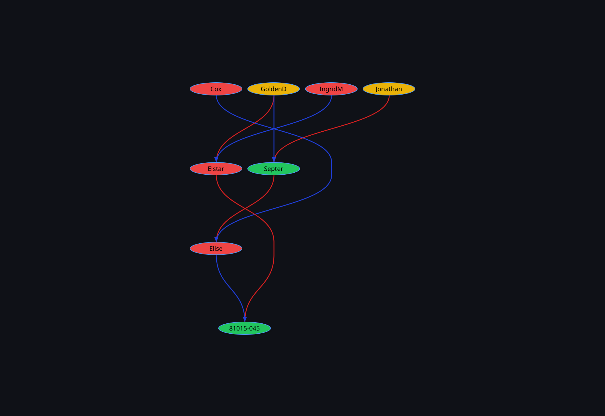
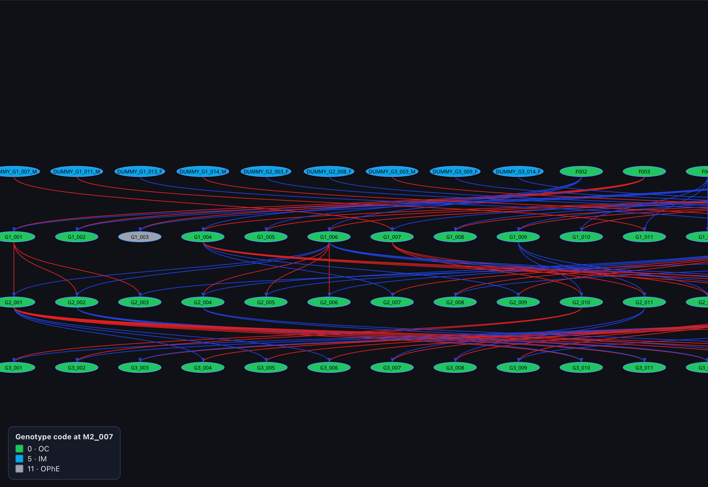
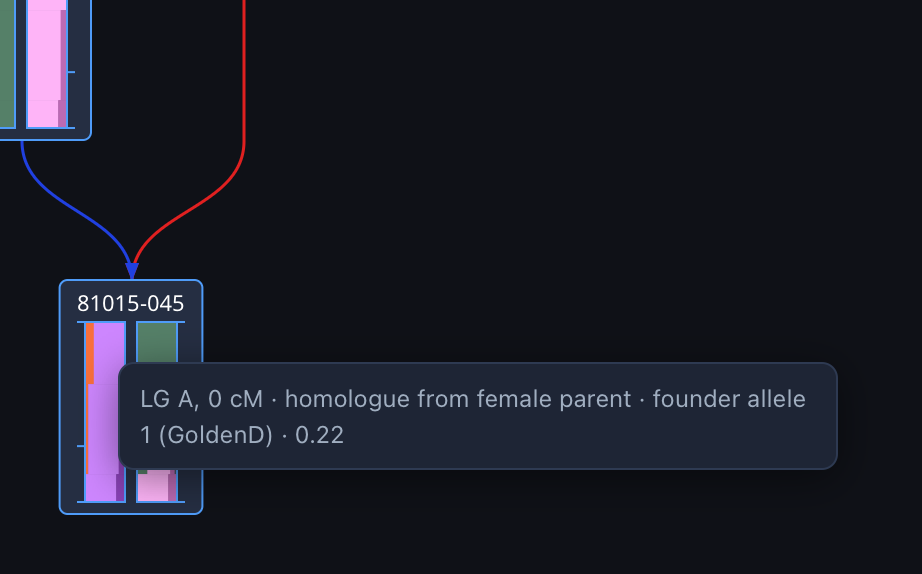
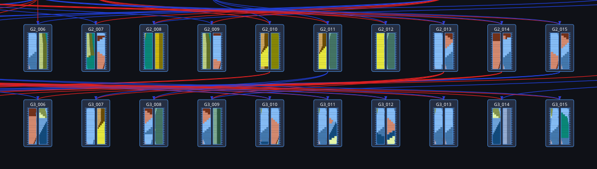
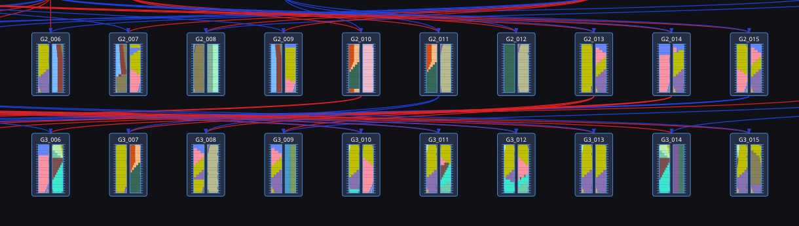

# Chapter 6 — Visualization

This chapter explains what the chart shows and how to read it: the layout,
the two display styles, the lines between parents and offspring, the
colorings by trait and by marker, and the IBD bars.

## Layout

Pedimap arranges the pedigree by generation. Founders are generation 0; any
other individual's generation is one more than the higher of its parents'
generations.

- **Top to bottom** (the default): each generation is a row, founders at the
  top.
- **Left to right**: each generation is a column, founders on the left.

Choose either under **Orientation** in the toolbar. Founders without
offspring sit in the founders' row.

## Display styles

| | Modern | Classic Pedimap |
|--------|----------------------------|----------------------------------|
| Background | dark | white |
| Individuals | shapes by cross type (below), name inside or underneath | rectangles with the name at the top, pale yellow, as in Pedimap 1.x |
| Lines | curved, with an arrow to the offspring | straight, without arrows |
| Cross symbols (×) | off by default | on by default |

In Modern style, the shape tells how an individual was produced:

| Shape | Individual |
|----------|--------------------------|
| ellipse (name inside) | a cross between two parents, a founder, or a mutant |
| diamond | from selfing (`*SELF`) |
| star | a doubled haploid (`*DH`) |
| square | a clone, from vegetative propagation (`*VP`) |

The details panel and the hover always give the cross type in words. With
IBD bars shown, every individual is a rectangle in both styles.

## Lines between parents and offspring

Each line joins an individual to one parent:

- **red** from the parent in the `FEMALE` column, or `MOTHER` or `PARENT1`;
- **blue** from the parent in the `MALE` column, or `FATHER` or `PARENT2`;
- **purple** for an individual with a single parent (`*SELF`, `*DH`, `*MUT`,
  `*VP`).

In most files these columns come in that order, so red is the line from the
first parent and blue the line from the second. Files from FlexQTL and
Binko.jl name the columns `PARENT1` and `PARENT2` and do not state the
parents' sex; files with `FEMALE` and `MALE` columns do, and there the first
parent is the female. A file may also list `MALE` before `FEMALE`: the
female's line is then still red.

**Cross symbols.** When cross symbols are on (**Settings → Show cross
symbols**), the lines from the two parents meet at a ×, and one line runs
from there to the offspring. Full sibs share one ×.

**Lines never pass through an individual they do not connect.** A line that
spans several generations runs in a lane of its own between the rows. When
you drag an individual within its row, the lines follow and keep clear of
every box.

## Coloring by a trait

Choose a trait under **Color by**.

**Continuous traits** (measurements) are colored on a scale from the
**Low** color, for the smallest value, to the **High** color, for the
largest. Individuals without a value take the **Missing** color. To choose
other colors, click a color next to **Color by**; **Reset** goes back to
the trait's own colors. Pedimap remembers your colors for each trait.

**Discrete traits** (categories) give each value its own color, listed in a
legend at the lower left of the chart. Values that are color names (`Red`,
`Green`, `Yellow`, …) are drawn in that color.

The name in each box is written in black or white, whichever reads better on
its color.

## Coloring by a marker

For files with marker data, **Color by** also offers:

- **Genotype code at marker…**: each individual takes the color of its
  genotype code at the marker you choose in the **Marker** menu. In FlexQTL
  and Binko files the legend gives each code's short name
  ([Appendix B](09_faq.md#appendix-b-flexqtl-genotype-codes)); in other files
  the codes are only colors.
- **Allele at marker…**: each individual is colored by how many copies of an
  allele it carries (0, 1 or 2), for the marker and the allele you choose in
  the **Marker** and **Allele** menus. The three colors stay distinct for
  color-blind readers and in grayscale. If one of an individual's alleles is
  unknown, its number of copies is unknown, and it is drawn hatched gray.

In this example, the dummy founders have no genotypes (code 5, IM: missing
and not filled in), and one individual has code 11 (OPhE).

## Reading the IBD bars

For a file with IBD probabilities, choose a linkage group under **IBD bars**.
Each individual's box then holds two bars.

### Two bars, two chromosome copies

Each bar is one **homologue**: one of the individual's two copies of the
linkage group.

- The **left** bar is the homologue from the parent in the file's first
  parent column, the **right** bar the one from the second. Hold the mouse
  over a bar to see which parent it is ("homologue from female parent", or
  "from parent 1").
- A bar runs along the linkage group's map, from its start at the top to its
  end at the bottom (left to right turns the chart, not the bars).

### Positions and bands

The file gives IBD probabilities at certain positions (cM). Each position
colors a **band** of the bar: from halfway to the previous position to
halfway to the next one; the first and last bands reach the ends of the bar.
A short tick on the outer side of the bar marks each IBD position, and a
smaller tick each marker that is not at an IBD position. Nothing is
interpolated between positions: a band shows the probabilities of its own
position.

### Colors: which founder allele

Across its width, a band is split into **segments**, one for each founder
allele with a probability, as wide as its probability. Segments come in
founder-allele order, so a change of color from one band to the next shows a
recombination, not a reshuffle.

Where the bar is a single color, the homologue descends from that founder
allele with certainty. A founder's own bars are one color each: a founder
carries its own two alleles. This holds for founders without data too,
such as Binko.jl's dummy founders.

Hold the mouse over a segment to read it: "LG A, 0 cM · homologue from
female parent · founder allele 1 (GoldenD) · 0.22" gives the linkage group,
the position, the homologue, the founder allele with its founder, and the
probability as the file gives it. (FlexQTL rounds its probabilities, so those
of a homologue can add up to slightly more or less than 1; the bars are
drawn as if they added up to exactly 1.)

### Palettes

Choose the palette under **Settings → IBD bars → Palette**:

- **By founder** (the default): each founder has its own hue, its first
  allele in a light shade and its second in a dark shade. You can see at a
  glance which founder a segment comes from.
- **By founder allele**: each founder allele has its own color. With many
  founders, this tells colors apart better.

Colors are shared out over the founders whose alleles occur in the
individuals shown. A subpopulation with few founders therefore gets colors
that differ more than the whole population's. The colors were chosen to stay
apart for the three common kinds of color blindness as well. With dozens of
founders, some colors are still alike; hold the mouse over a segment, or
look at the details panel, to be sure.

In an exported image, a legend lists each founder with the numbers and
colors of its founder alleles ([Chapter 7](07_data_export.md)).

### The gray remainder and the bar width

A probability too small to draw as a segment of its own is drawn together
with the other small ones as one **dark gray** segment at the end of the
band. Hold the mouse over it to see the founder alleles it holds and their
probabilities.

What counts as small depends on the bar width: a segment narrower than one
pixel is merged. With the default width of 20 pixels, probabilities below
0.05 are merged; at 10 pixels, those below 0.10; at 25 pixels, those below
0.04. To change the width, use **Settings → IBD bars → Bar width**; the
line below it says which probabilities are merged at the width you choose.
Exported images use the same width, and their legend says what was merged.

### Individuals without IBD data

An individual without IBD probabilities in the file has hatched gray bars,
as other unknown values are drawn. Files from FlexQTL and Binko.jl give every
individual probabilities, so you will rarely see this.
