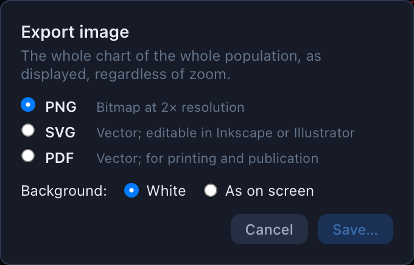
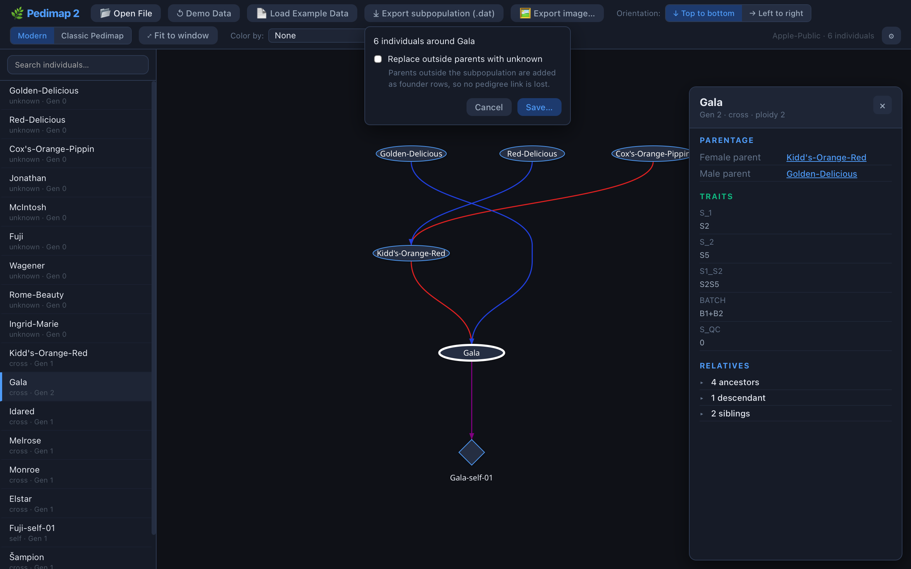

# Chapter 7 — Exporting

Pedimap 2 saves two kinds of files: **images** of the chart, for reports,
slides and papers, and **data files** (`.dat`) of the pedigree or of a part
of it.

## Saving an image of the chart

Click **Export image…** in the toolbar.

The image always holds the **whole chart as displayed**: the whole
population, or the subpopulation you are showing, however far you have
zoomed or moved. It uses the current display style and orientation, with
the same colors, lines, cross symbols and IBD bars as on screen.

**Format**

| Format | Use it for |
|----|------------------------------------------------------------|
| **PNG** | Slides and documents. Saved at twice the screen resolution. A very large chart is saved at a lower resolution, so that neither side exceeds 16,000 pixels; Pedimap then says so, and suggests SVG or PDF for full detail. |
| **SVG** | Editing in Inkscape or Illustrator: a drawing in which every name is text. |
| **PDF** | Printing and publication: a drawing with names as text. Under **Page**, choose **Fitted to the chart**, **US Letter, landscape** or **A4, landscape** (the chart is scaled to fit inside the margins). |

**Background:** **White** (the default) puts the chart on a white page, for
print; **As on screen** keeps the display style's own background, such as
Modern's dark one.

Click **Save…** and choose where to save the file. Pedimap suggests a name
from the pedigree's name, for example `Apples.png` for the example pedigree,
or `Apple-Public_Gala_subpop.png` for a subpopulation around Gala in a
pedigree named Apple-Public.

**Legends.** The image carries a legend for the coloring (the trait or the
marker) and, with IBD bars shown, a legend of the founder alleles: one row
per founder, with a numbered swatch for each of its alleles in the image,
and the gray of merged small probabilities when there is any. Its title
names the linkage group and the probability below which segments are
merged, for example "Founder alleles, linkage group A (below 0.05 merged)".
The legends go below a top-to-bottom chart and to the right of a
left-to-right chart, and the page grows so that they never cover the chart.

**Names** are set in Noto Sans, which comes with Pedimap 2 and is embedded
in every image, so accented and non-Latin names look right on any computer.

While a pedigree is too large to draw (above the drawing limit,
[Chapter 8](08_advanced.md)), it cannot be exported as an image; build a
subpopulation first.

## Saving the pedigree as a data file (.dat)

Click **Export .dat** in the toolbar, then choose where to save the file.

The file is a Pedimap `.dat` file with everything Pedimap read: the header
keywords, the pedigree with every trait column, single-parent descent
(`*SELF`, `*DH`, `*MUT`, `*VP`), the linkage groups, the marker data and the
IBD probabilities. Opened again, it gives the same data. A parent that had no
line of its own in the original file gets one.

Pedimap also writes a few comment lines that start with `; PEDIMAP2`. They
record, for example, whether each trait is discrete or continuous, so that a
part of a population keeps its traits' types. Pedimap 1.x and other programs
ignore them, as they ignore every comment.

The file is saved in UTF-8.

### Saving a subpopulation

While a subpopulation is shown ([Chapter 8](08_advanced.md)), the button
reads **Export subpopulation (.dat)** and opens a small panel:

- It says how many individuals will be written ("6 individuals around
  Gala").
- **Replace outside parents with unknown**, off by default:
  - **off**: a parent outside the subpopulation is written as a founder
    row of its own, so no link in the pedigree is lost;
  - **on**: only the individuals shown are written, and their links to
    parents outside them are dropped (those parents become unknown).

Click **Save…** to choose where to save the file.

**IBD probabilities in a subpopulation.** The exported file keeps the IBD
probabilities exactly as in the whole population, numbered by the whole
population's founder alleles, and says so in a comment line. Its founders'
alleles may therefore belong to founders that are not in the file. Pedimap 2
reads such files; whether Pedimap 1.x does has not been tested.

## What Pedimap does not save yet

- **JSON files.** Pedimap opens `.json` files but cannot yet save one.
- **Changes to the data.** Pedimap shows your data; it does not edit it. To
  correct a name or a value, edit the data file and open it again.
- **Printing.** Save a PDF and print it from your PDF viewer.
