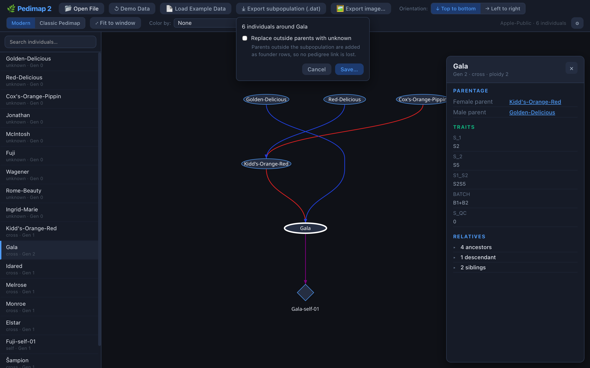
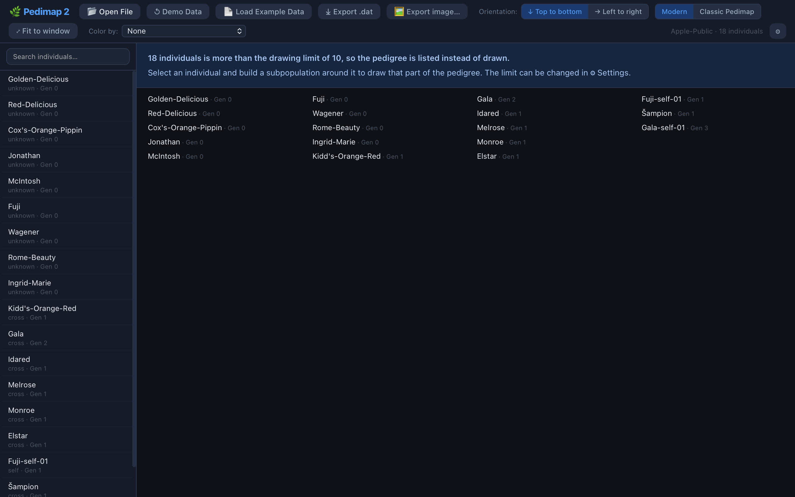

# Chapter 8 — Advanced use

## Subpopulations

A large pedigree is easier to read in parts. A **subpopulation** shows one
individual with all of its ancestors and all of its descendants, and nothing
else.

1. Select the individual: click it on the chart, or its name in the list on
   the left.
2. Click **Subpop:** *name* in the toolbar.

The chart now shows only that part of the pedigree; the toolbar shows how
many individuals it holds. Everything works on it as on the whole
population: coloring, IBD bars, the details panel and image export. Click
**Show All** to see the whole population again.

- **IBD colors** are shared out over the founders whose alleles occur in the
  subpopulation, so a subpopulation with few founders gets colors that differ
  more ([Chapter 6](06_visualization.md)).
- **Saving it:** **Export subpopulation (.dat)** writes the subpopulation as
  a data file ([Chapter 7](07_data_export.md)).
- **What is not available yet:** a subpopulation always holds all ancestors
  and all descendants. Pedimap 1.x could also select relatives by maternal or
  paternal line, up to a number of generations, and keep several named
  subpopulations; Pedimap 2 does not do that yet.

## Large pedigrees and the drawing limit

Arranging a chart takes longer the more individuals it has. Above the
**drawing limit**, 1,000 individuals by default, Pedimap lists the
individuals instead of drawing them:

To see part of such a pedigree, click an individual in the list and then
**Build subpopulation around** *name*: the subpopulation is drawn if it is
within the limit.

To draw larger pedigrees, raise the limit under **Settings → Drawing limit
(individuals)**: type the number and press Enter (or click elsewhere).
Pedimap remembers it. Drawing several thousand individuals can take many
seconds and make moving around the chart slow.

- From 600 individuals on, Pedimap uses a quicker arrangement, which may
  leave some lines longer than necessary.
- Above 1,000 individuals, it shows "Laying out…" while it arranges the
  chart.

## Working with FlexQTL and Binko.jl results

- **Linkage groups.** Choose the group under **IBD bars**. Only groups with
  IBD positions are offered; when you open another file, Pedimap keeps your
  group if the new file has it, and otherwise takes its first.
- **Many founders.** With dozens of founders, some colors are alike. Switch
  the palette to **By founder allele** (**Settings → IBD bars**), widen the
  bars, or show a subpopulation, which has fewer founders and so more
  distinct colors. Holding the mouse over a segment always names its founder
  allele.
- **Small probabilities** are merged into a dark gray segment. To see more of
  them as segments of their own, widen the bars: at 40 pixels, only
  probabilities below 0.025 are merged.
- **Genotype codes.** Color the chart by **Genotype code at marker…** to see
  where genotypes were filled in or judged to be errors; the meanings of the
  codes are in [Appendix B](09_faq.md#appendix-b-flexqtl-genotype-codes).
- **Files read by older versions.** If you opened a FlexQTL file with more
  than one linkage group in Pedimap 2.2.2 or earlier, open the original file
  again: those versions mixed up the IBD probabilities of such files.
